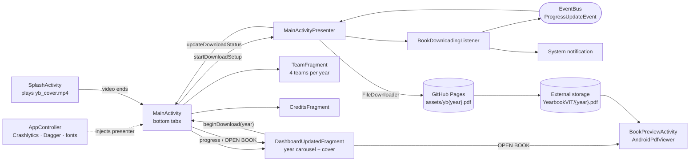

<p align="center"></p>

<p align="center"></p>

<p align="center">
  <a href="LICENSE"></a>
  
  
  <a href="https://github.com/abhinav-adtechs/Yearbook-Android-Client/commits/master"></a>
  <a href="https://github.com/abhinav-adtechs/Yearbook-Android-Client/stargazers"></a>
  <a href="https://www.facebook.com/RewindVIT/"></a>
  <a href="CONTRIBUTING.md"></a>
</p>

<p align="center"><b>The official Yearbook app of VIT University — pick an edition by year, download it once, read it offline.</b></p>

<p align="center">
  <a href="#-features">Features</a> ·
  <a href="#-quick-start">Quick start</a> ·
  <a href="#-architecture">Architecture</a> ·
  <a href="#-docs">Docs</a> ·
  <a href="#-roadmap">Roadmap</a> ·
  <a href="#-contributing">Contributing</a>
</p>

<p align="center">
  
  &nbsp;&nbsp;
  
</p>
<p align="center"><sub>The two covers bundled with the app (<code>res/drawable/yb2017_cover.webp</code>, <code>yb2016_cover.webp</code>).</sub></p>

> [!NOTE]
> **Status: archived classic.** Built in September–October 2017 (61 commits, last `versionName` is `beta-0.3`). It is not actively maintained and targets the Android toolchain of its day. As of November 2026 the PDF host referenced in [`Constants.java`](app/src/main/java/in/vit/yearbook/Model/Utils/Constants.java) still serves all four editions.

## Why Yearbook VIT?

VIT's student yearbook, _Rewind_, is published as large PDFs — up to 75 MB for a single edition. Passing those files around is clumsy on a phone, so this app gives students one place to find an edition by year, download it in the background with a progress notification, and read it offline in a built-in PDF reader. It also credits the people behind each book: the editorial, design, photography and management teams, browsable year by year.

## ✨ Features

<table>
  <tr>
    <td width="50%" valign="top">
      <h4>🎬 Video splash</h4>
      Plays the bundled intro clip (<code>res/raw/yb_cover.mp4</code>) full screen, then hands off to the dashboard. If playback fails, it skips straight ahead.
    </td>
    <td width="50%" valign="top">
      <h4>📚 Year carousel</h4>
      A horizontal, snapping, centre-zoom carousel (<code>CenterZoomLayoutManager</code> + <code>LinearSnapHelper</code>) for 2017, 2016, 2015 and 2014. The cover swaps as you scroll.
    </td>
  </tr>
  <tr>
    <td valign="top">
      <h4>⬇️ Background downloads</h4>
      Tap a cover to reveal the download button with the edition's size (2–75 MB). <a href="https://github.com/lingochamp/FileDownloader">FileDownloader</a> saves it to <code>YearbookVIT/&lt;year&gt;.pdf</code> on external storage.
    </td>
    <td valign="top">
      <h4>🔔 Live progress</h4>
      Pending, progress, paused, completed and error states go to an in-app <code>NumberProgressBar</code> through EventBus, and to a system notification that reopens the app.
    </td>
  </tr>
  <tr>
    <td valign="top">
      <h4>📖 Offline reader</h4>
      Once a book is on disk, the button switches to <b>OPEN BOOK</b>. <code>BookPreviewActivity</code> renders it with AndroidPdfViewer: swipe, anti-aliasing, scroll handle, fit-to-width.
    </td>
    <td valign="top">
      <h4>👥 Team pages</h4>
      Pick a year, then toggle <b>Editorial · Design · Photography · Management</b> to see who made that edition. Lists load from string arrays and animate in with a fall-down layout animation.
    </td>
  </tr>
  <tr>
    <td valign="top">
      <h4>💛 Credits</h4>
      A credits tab for the team behind the app and the open-source libraries it uses.
    </td>
    <td valign="top">
      <h4>🔥 Firebase + Crashlytics</h4>
      Firebase Cloud Messaging for push notifications and Crashlytics (via Fabric) for crash reports, set up in <code>AppController</code>.
    </td>
  </tr>
</table>

## 🧰 Tech stack

**Language & build**
<br>


**Architecture**
<br>


**Downloads & reading**
<br>


**Services**
<br>


## 🏗 Architecture

A small MVP-style app: Activities and Fragments are the view, `MainActivityPresenter` owns downloads, and EventBus carries progress back to the UI. Dagger injects the presenter into `MainActivity`.



The full walkthrough — screens, the download pipeline and its states, and where each piece of data lives — is in [`docs/ARCHITECTURE.md`](docs/ARCHITECTURE.md).

## 🚀 Quick start

> [!WARNING]
> This is a 2017 Gradle project (Android Gradle Plugin 2.3.3, Support Library 25, Fabric). It does **not** sync in a current Android Studio as-is, and the repo ships without `settings.gradle` or a Gradle wrapper.

**Era-accurate setup.** You need:

- JDK 8
- Android SDK Platform 25 and Build-Tools 25.0.3
- Android Studio from the 2.3/3.0 era, or Gradle 3.3+ (the minimum for AGP 2.3.x)

```bash
git clone https://github.com/abhinav-adtechs/Yearbook-Android-Client.git
cd Yearbook-Android-Client

# The repo has no settings.gradle — register the app module
echo "include ':app'" > settings.gradle
```

Then open the folder in Android Studio, accept the prompt to create a Gradle wrapper, and run the `app` configuration on a device or emulator running Android 4.3 (API 18) or later. On Android 6.0+ the app asks for storage permission the first time you tap download.

> [!TIP]
> **Opening it in a modern Android Studio?** Current versions can't sync AGP 2.3.3. To get it building today:
>
> 1. Add `settings.gradle` and a recent Gradle wrapper.
> 2. Bump AGP and replace `jcenter()` with `google()` and `mavenCentral()`.
> 3. Change `compile` to `implementation`.
> 4. Remove the Fabric plugin and repository (Fabric has been shut down).
> 5. Run **Refactor ▸ Migrate to AndroidX**.
>
> This work is tracked in the [roadmap](#-roadmap).

## ⚙️ Configuration

There are no environment variables. These are the knobs in the source:

| Setting                 | Where                                                                                                                                                                                                                          | What it does                                                                 |
| ----------------------- | ------------------------------------------------------------------------------------------------------------------------------------------------------------------------------------------------------------------------------ | ---------------------------------------------------------------------------- |
| `BASE_URL`, `URL_BOOK`  | [`Model/Utils/Constants.java`](app/src/main/java/in/vit/yearbook/Model/Utils/Constants.java)                                                                                                                                   | Where the PDFs are downloaded from: `BASE_URL + URL_BOOK + year + ".pdf"`    |
| Download path           | [`Presenter/Main/MainActivityPresenter.java`](app/src/main/java/in/vit/yearbook/Presenter/Main/MainActivityPresenter.java)                                                                                                     | `<external storage>/YearbookVIT/<year>.pdf` (also checked in `MainActivity`) |
| Editions, covers, sizes | [`DashYearAdapter.java`](app/src/main/java/in/vit/yearbook/View/NewUI/Dashboard/DashYearAdapter.java), [`DashboardUpdatedFragment.java`](app/src/main/java/in/vit/yearbook/View/NewUI/Dashboard/DashboardUpdatedFragment.java) | Hard-coded years 2017–2014, cover drawables and size labels                  |
| Team lists              | [`res/values/strings.xml`](app/src/main/res/values/strings.xml)                                                                                                                                                                | `yb2017_team_*` and `yb2016_team_*` string arrays                            |
| Firebase                | `app/google-services.json`                                                                                                                                                                                                     | Firebase project for Cloud Messaging. Use your own project if you fork.      |
| Crashlytics (Fabric)    | `app/fabric.properties`, `io.fabric.ApiKey` in `AndroidManifest.xml`                                                                                                                                                           | Legacy crash reporting. Fabric has been shut down; replace or remove it.     |
| App identity            | [`app/build.gradle`](app/build.gradle)                                                                                                                                                                                         | `applicationId "in.vit.yearbook"`, `versionCode 3`, `versionName "beta-0.3"` |

Permissions requested: `INTERNET`, `WRITE_EXTERNAL_STORAGE`, `WAKE_LOCK`.

## 🗂 Project structure

```text
Yearbook-Android-Client/
├── build.gradle                         # root: AGP 2.3.3, Kotlin 1.1.50, google-services
└── app/
    ├── build.gradle                     # SDK 25, dependencies, Fabric + google-services plugins
    ├── google-services.json             # Firebase project config
    └── src/main/
        ├── AndroidManifest.xml          # SplashActivity is the launcher
        ├── yb_logo-web.png              # 512×512 app logo
        ├── assets/fonts/                # Varela Round, Montserrat Bold
        ├── res/raw/yb_cover.mp4         # splash video
        ├── res/drawable/yb201{6,7}_cover.webp
        ├── res/values*/                 # colours, per-density dimens, team string arrays
        └── java/in/vit/yearbook/
            ├── AppController.java       # Application: Crashlytics, Dagger graph, default font
            ├── Dagger/                  # AppComponent + SharedPrefModule
            ├── Model/                   # ProgressUpdateEvent, BookDownloadingListener, Constants, utils
            ├── Presenter/               # MainActivityPresenter (downloads ↔ EventBus) + interfaces
            └── View/
                ├── NewUI/               # current UI: MainActivity, Dashboard, Team, Credits
                └── OldUI/               # first-iteration UI; Splash, PDF reader and
                                         # CenterZoomLayoutManager are still used from here
```

## 📚 Docs

- [`docs/ARCHITECTURE.md`](docs/ARCHITECTURE.md): screens, download pipeline, data and file locations, known quirks
- [`CHANGELOG.md`](CHANGELOG.md): release history from `beta-0.1` to `beta-0.3`
- [`CONTRIBUTING.md`](CONTRIBUTING.md): setup, conventions and the PR checklist

## 🧭 Roadmap

- [ ] Add `settings.gradle` and a Gradle wrapper so the project opens without manual steps
- [ ] Migrate the build to a current AGP, AndroidX and Maven Central
- [ ] Replace Fabric Crashlytics with Firebase Crashlytics (or remove it) and stop tracking its config
- [ ] Save downloads to app-specific storage (scoped storage, Android 10+)
- [ ] Load the yearbook catalogue (years, covers, sizes, URLs) from a remote manifest
- [ ] Give 2015 and 2014 their own covers and team lists
- [ ] Track download state explicitly instead of comparing strings with `==`
- [ ] Add real screenshots and a short demo GIF to this README

Device-specific layout fixes are tracked in [#2](https://github.com/abhinav-adtechs/Yearbook-Android-Client/issues/2).

## 🤝 Contributing

Issues and pull requests are welcome, including small ones. Read [`CONTRIBUTING.md`](CONTRIBUTING.md) for setup, Conventional Commit style and the PR checklist.

## 🙏 Acknowledgements

- **Abhinav Das**: author of every commit in this repository.
- **Ajay Kumar**: credited with Abhinav Das on the app's Credits screen ("Designed and Developed with ❤ by Ajay Kumar and Abhinav Das", [`CreditsFragment.java`](app/src/main/java/in/vit/yearbook/View/NewUI/Credits/CreditsFragment.java)).
- **The Rewind VIT yearbook team** (editorial, design, photography and management), whose books this app delivers.
- The open-source libraries credited in the app: EventBus (greenrobot), Dagger 2 (Google), ButterKnife (Jake Wharton), AndroidPdfViewer (barteksc), FileDownloader (lingochamp), NumberProgressBar (daimajia) and lottie-android (Airbnb). Lottie was used during development and later removed from the build; its JSON animations are still in `assets/`.

## 📄 License

[MIT](LICENSE) © 2017–2026 Abhinav Das

The yearbook covers, logo and splash video belong to the Rewind VIT yearbook team and are included for the app's own use.

## Star history

<a href="https://star-history.com/#abhinav-adtechs/Yearbook-Android-Client&Date"></a>

---

<p align="center">Built by <a href="https://github.com/abhinav-adtechs">Abhinav Das</a><br><sub>If this project helped you, consider giving it a ⭐</sub></p>
