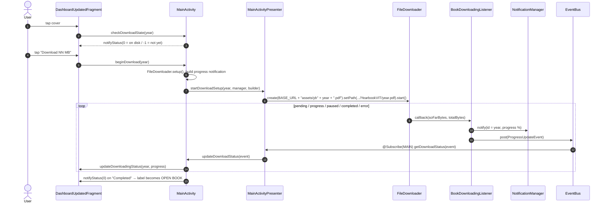
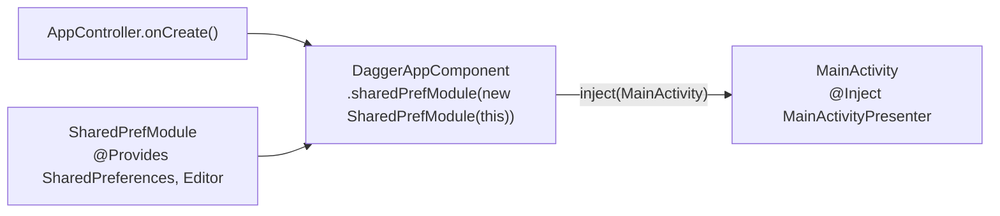

# Architecture

This page explains how Yearbook VIT works inside. It covers the screens, the download pipeline, where data lives, and the parts of the 2017 codebase that are still wired in versus left over. All paths are relative to `app/src/main/`.

- [At a glance](#at-a-glance)
- [Entry points](#entry-points)
- [Package layout](#package-layout)
- [Screens](#screens)
- [Download pipeline](#download-pipeline)
- [Data: editions, teams, files](#data-editions-teams-files)
- [Dependency injection](#dependency-injection)
- [External services](#external-services)
- [Live code vs. leftovers](#live-code-vs-leftovers)
- [Known quirks](#known-quirks)

## At a glance

|                           |                                                                                                       |
| ------------------------- | ----------------------------------------------------------------------------------------------------- |
| Package / `applicationId` | `in.vit.yearbook`                                                                                     |
| SDK levels                | `minSdkVersion 18`, `targetSdkVersion 25`, `compileSdkVersion 25`                                     |
| Version                   | `versionCode 3`, `versionName "beta-0.3"`                                                             |
| Pattern                   | MVP-ish: View (Activities/Fragments) → Presenter → model/listener, with EventBus carrying events back |
| Languages                 | Java, plus one Kotlin file (`View/OldUI/Team/TeamRVAdapter.kt`, legacy)                               |
| Permissions               | `INTERNET`, `WRITE_EXTERNAL_STORAGE`, `WAKE_LOCK`                                                     |

## Entry points

Declared in [`AndroidManifest.xml`](../app/src/main/AndroidManifest.xml):

| Component                                           | Role                                                                                                                                                   |
| --------------------------------------------------- | ------------------------------------------------------------------------------------------------------------------------------------------------------ |
| `AppController` (`android:name` of `<application>`) | Starts Crashlytics through Fabric, builds the Dagger `AppComponent`, and replaces the default `MONOSPACE` typeface with Varela Round (`FontsOverride`) |
| `View.OldUI.Introduction.SplashActivity`            | **Launcher.** Portrait, full screen; plays `res/raw/yb_cover.mp4`                                                                                      |
| `View.NewUI.MainActivity`                           | Main shell: title bar, fragment frame, three bottom tabs                                                                                               |
| `View.OldUI.Preview.BookPreviewActivity`            | PDF reader                                                                                                                                             |
| `View.NewUI.TestingActivity`                        | Development scratch screen; nothing in the app launches it                                                                                             |

## Package layout

```text
java/in/vit/yearbook/
├── AppController.java
├── Dagger/
│   ├── Components/AppComponent.java      # @Singleton component, inject(MainActivity)
│   └── Modules/SharedPrefModule.java     # provides SharedPreferences "YEARBOOK_PREF" + Editor
├── Model/
│   ├── UIModels/
│   │   ├── BookDownloadingListener.java  # FileDownloadLargeFileListener → notification + EventBus
│   │   ├── ProgressUpdateEvent.java      # {year, progress, statusString}
│   │   └── DashboardBook.java
│   └── Utils/
│       ├── Constants.java                # tab/team state ids, BASE_URL, URL_BOOK
│       ├── AnimationUtils.java           # slide left/right, fade in/out
│       └── FontsOverride.java
├── Presenter/
│   ├── Main/MainActivityPresenter.java   # starts downloads, subscribes to ProgressUpdateEvent
│   ├── Main/MainActivityInterface.java   # updateDownloadStatus(event)
│   ├── Main/MainActivityCommunicationInterface.java  # notifyStatus / updateDownloadingStatus / scrollToYear
│   └── Dashboard/DashboardCommunicationInterface.java # beginDownload / checkDownloadState
└── View/
    ├── NewUI/   # MainActivity, Dashboard/, Team/, Credits/
    └── OldUI/   # SplashActivity, BookPreviewActivity, CenterZoomLayoutManager (+ first-iteration UI)
```

## Screens

### 1. Splash: `SplashActivity`

- Draws on a `SurfaceView` with a `MediaPlayer` that is prepared on a background thread from `android.resource://…/raw/yb_cover`.
- `onCompletion` starts `NewUI.MainActivity` and finishes. If preparing the video throws, it jumps to `MainActivity` straight away.

### 2. Shell: `NewUI.MainActivity`

- Layout `new_activity_main.xml`: a title bar showing _Dashboard_, _Team_ or _Credits_, a `FrameLayout` for fragments, and three `ImageButton` tabs (team, dashboard, info).
- Tab switches call `makeFragmentTransaction()` with a slow fade. The active tab icon scales up to 1.2× and is made non-clickable. `currentState` stores one of `STATE_DASHBOARD`, `STATE_TEAM` or `STATE_CREDITS`.
- The dashboard fragment instance is kept in `dashboardFragment` and reused. Team and Credits are created fresh on each switch.
- Implements `DashboardCommunicationInterface` (called by the dashboard) and `MainActivityInterface` (called by the presenter).

### 3. Dashboard: `DashboardUpdatedFragment`

- `new_fragment_dashboard.xml`: a large cover `ImageView`, a download `Button`, a `NumberProgressBar`, and a horizontal year `RecyclerView`.
- The year list uses `DashYearAdapter` (`2017, 2016, 2015, 2014`), `CenterZoomLayoutManager` (items shrink away from the centre) and a `LinearSnapHelper`. When scrolling settles, `setBooks(position)` swaps the cover and sets `currentYear`.
- Tapping the cover calls `mainActivity.checkDownloadState(year)`, slides the cover left and fades in the button and progress bar. Tapping again hides them.
- The button:
  - asks for `WRITE_EXTERNAL_STORAGE` if it hasn't been granted;
  - opens `BookPreviewActivity` with the file path if the label is `OPEN BOOK`;
  - otherwise calls `mainActivity.beginDownload(year)`.
- Labels: `Download 75MB` (2017), `Download 42MB` (2016), `Download 2MB` (2015), `Download 6MB` (2014), `DOWNLOADING...`, `OPEN BOOK`.

### 4. Team: `NewUI.Team.TeamFragment`

- Inflates `testing_activity_test.xml`, which has the same year carousel plus four category buttons: Editorial, Design, Photography and Management.
- `updateEditorialTeam(year)` and its three siblings load the matching string array into `TeamMembersAdapter`. They also highlight the selected button (`rounded_border_action_bar_filled`) and replay the `layout_animation_fall_down` animation.

### 5. Credits: `CreditsFragment`

- A "Designed and Developed with ❤ by …" line, followed by the `credits_list` string array (open-source libraries) rendered through `TeamMembersAdapter`.

### 6. Reader: `BookPreviewActivity`

- Reads the `fileName` extra. If the file is missing, it toasts "File does not Exist! Sorry" and backs out.
- Otherwise it calls `PDFView.fromFile(...)` with anti-aliasing, swipe, a `DefaultScrollHandle` and `fitToWidth()` (re-applied on configuration change).

## Download pipeline



**States.** `BookDownloadingListener` sets `ProgressUpdateEvent.statusString` and the notification text:

| Callback    | `statusString` | Progress                        |
| ----------- | -------------- | ------------------------------- |
| `pending`   | `Pending`      | 0                               |
| `progress`  | `Downloading`  | `soFarBytes / totalBytes × 100` |
| `paused`    | `Paused`       | last computed %                 |
| `completed` | `Completed`    | 100                             |
| `error`     | `Error`        | unchanged                       |

The presenter registers with EventBus in `MainActivity.onResume()` and unregisters in `onPause()`, so the UI only updates while the activity is in the foreground. The notification keeps showing progress either way.

## Data: editions, teams, files

| Edition | Carousel position | Cover drawable          | Size label | Remote file         | Team arrays                                             |
| ------- | ----------------- | ----------------------- | ---------- | ------------------- | ------------------------------------------------------- |
| 2017    | 0                 | `yb2017_cover`          | 75 MB      | `assets/yb2017.pdf` | `yb2017_team_{editorial,design,photography,management}` |
| 2016    | 1                 | `yb2016_cover`          | 42 MB      | `assets/yb2016.pdf` | `yb2016_team_{editorial,design,photography,management}` |
| 2015    | 2                 | `yb2016_cover` (reused) | 2 MB       | `assets/yb2015.pdf` | falls back to `yb2017_team_editorial`                   |
| 2014    | 3                 | `yb2016_cover` (reused) | 6 MB       | `assets/yb2014.pdf` | falls back to `yb2017_team_editorial`                   |

- **Remote host:** `Constants.BASE_URL` points at a GitHub Pages site. The full URL is `BASE_URL + URL_BOOK + year + ".pdf"`.
- **On device:** `Environment.getExternalStorageDirectory() + "/YearbookVIT/" + year + ".pdf"`. The same path is built in `MainActivity.checkDownloadState()`, `MainActivityPresenter.startDownloadSetup()` and `DashboardUpdatedFragment`.
- **Preferences:** `SharedPrefModule` provides a `SharedPreferences` named `YEARBOOK_PREF`. Nothing reads or writes it yet.

## Dependency injection



`MainActivityPresenter` has an `@Inject` constructor, so Dagger builds it without a module binding. ButterKnife (`@BindView`) handles view binding in every Activity and Fragment.

## External services

| Service                  | Wiring                                                                                                | Notes                                                                               |
| ------------------------ | ----------------------------------------------------------------------------------------------------- | ----------------------------------------------------------------------------------- |
| Firebase Cloud Messaging | `firebase-messaging:10.0.1` plus the `google-services` plugin and `app/google-services.json`          | No custom `FirebaseMessagingService`. Notifications use the SDK's default handling. |
| Crashlytics (Fabric)     | `io.fabric` Gradle plugin, `crashlytics:2.7.0`, `app/fabric.properties`, `io.fabric.ApiKey` meta-data | Fabric has since been shut down; see the roadmap                                    |
| GitHub Pages             | `Constants.BASE_URL`                                                                                  | Static hosting for the four PDFs                                                    |

## Live code vs. leftovers

The app was rebuilt mid-project (the "revamp ui" and "new fixed ui setup" commits). The new screens live in `View/NewUI`, but a few classes from the first version are still in use:

| Still used                                | Not referenced by the running app                                                                                                                |
| ----------------------------------------- | ------------------------------------------------------------------------------------------------------------------------------------------------ |
| `OldUI/Introduction/SplashActivity`       | `OldUI/Dashboard/MainActivity`, `OldUI/Dashboard/DashboardFragment`, `OldUI/About/AboutFragment`, `OldUI/Team/TeamFragment` + `TeamRVAdapter.kt` |
| `OldUI/Preview/BookPreviewActivity`       | `OldUI/Introduction/SplashGridAdapter`, `OldUI/Dashboard/BooksAdapter`                                                                           |
| `OldUI/Dashboard/CenterZoomLayoutManager` | `NewUI/Dashboard/DashboardFragment`, `DownloadDashFragment`, `DownloadPreviewFragment`                                                           |
| `OldUI/BaseActivity`                      | `NewUI/TestingActivity` (its layout _is_ reused by `TeamFragment`), `Presenter/Dashboard/DashboardPresenter` (empty)                             |

`assets/book_flip.json` and `assets/splash_screen.json` are Lottie animations from an earlier iteration. The Lottie dependency has since been removed from `app/build.gradle`.

## Known quirks

- **2015/2014 placeholders.** These editions reuse the 2016 cover, and all four team tabs fall back to the 2017 editorial list.
- **String identity checks.** `morphingBtnDownload.getText() == "OPEN BOOK"` and `progressUpdateEvent.getStatusString() == "Completed"` compare references, not contents.
- **Storage model.** Downloads go to the shared external-storage root. That relies on `WRITE_EXTERNAL_STORAGE` and pre-Android 10 storage behaviour.
- **No `settings.gradle` or wrapper.** These must be added before the project will open (see the README quick start).
- **Device layouts.** Per-density `dimens.xml` files exist for mdpi, hdpi, xhdpi and xxhdpi; remaining device-specific fixes are tracked in issue #2.
